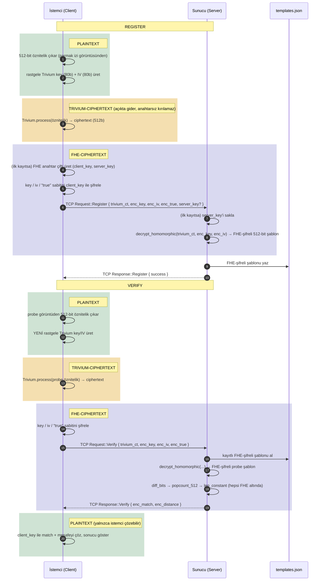

# fingerprint-fhe

Sunucunun ham (plaintext) parmak izi verisini **hiçbir zaman** görmediği bir
parmak izi doğrulama prototipi. Gizlilik, **Tam Homomorfik Şifreleme (FHE)**
ve hafif bir akış şifresi olan **Trivium** üzerine kurulu bir
*transciphering* şemasıyla sağlanıyor.

> Araştırma/prototip amaçlı bir projedir; "Bilinen sınırlamalar" bölümünde
> dürüstçe belirtildiği gibi biyometrik tanıma doğruluğu henüz üretim
> seviyesinde değildir. Projenin asıl katkısı, FHE + transciphering ile
> çalışan uçtan uca sistem tasarımı ve performans değerlendirmesidir.

## Genel Bakış

Fikir şu: istemci parmak izinden çıkardığı 512-bit öznitelik vektörünü,
hafif bir akış şifresi olan **Trivium** ile şifreler (bu adım FHE kullanmaz,
çok hızlıdır). Bu şifreli veri, Trivium anahtarı/IV'si ile birlikte FHE
altında sunucuya gönderilir. Sunucu, FHE üzerinde çalışan bir Trivium devresi
(`TriviumFhe`) kullanarak bu veriyi **şifreli biçimde çözer** — sonuç her
zaman `FheBool` olarak kalır, sunucu düz metni hiçbir noktada görmez.
Eşleştirme (Hamming mesafesi hesaplama + eşik karşılaştırması) de tamamen
FHE devreleriyle, şifreli veri üzerinde yapılır.

Bu yaklaşımın amacı, tüm veriyi doğrudan FHE ile şifrelemenin (çok daha
pahalı) maliyetinden kaçınmak: pahalı FHE işlemleri yalnızca Trivium'un
sınırlı devresiyle ve eşleştirme mantığıyla sınırlı tutuluyor.

## Mimari ve Protokol

```
client/   → Parmak izi okuma, 512-bit öznitelik çıkarma, Trivium + FHE anahtar şifreleme, TCP istemcisi
server/   → TCP sunucusu, decrypt_homomorphic + FHE eşleştirme, templates.json veritabanı yönetimi
shared/   → Ortak protokol (Request/Response), Trivium, TriviumFhe, FHE eşleştirme devreleri, TCP framing (net.rs)
```

İstemci ve sunucu, uzunluk ön ekli (length-prefixed) JSON mesajlarla TCP
üzerinden konuşur (`shared::net`). Tehdit modeli **honest-but-curious**:
sunucu yalnızca FHE *evaluation key*'ine (`server_key`) sahiptir, istemcinin
*secret key*'ini (`client_key`) hiçbir zaman görmez — protokolden ne kadar
saparsa sapsın, elindeki hiçbir ciphertext'i çözemeyecek şekilde
yapısal olarak kısıtlıdır.

> **Not:** `client_key`, makine başına tek ve küresel bir anahtardır (her
> kullanıcıya özel değil) — `~/.fingerprint_client/client_key.bin`
> (Windows'ta `%APPDATA%\fingerprint_client\`). Bu, "her cihaz kendi
> anahtarı" modeli değil, denetimli bir kiosk/iş istasyonunun birden fazla
> kullanıcı kaydettiği senaryoyu modelleyen **bilinçli bir tasarım
> kararıdır**: bu dosyanın ele geçmesi, o istasyondan kaydedilmiş tüm
> şablonları ifşa eder.



## Gereksinimler

- Rust (2021 edition, `cargo`)
- Linux/macOS/Windows, **x86_64** (FHE kütüphanesi `tfhe` bu mimari için derleniyor)

## Kurulum ve Çalıştırma

```bash
git clone git@github.com:Rabiayvz/fingerprint-fhe.git
cd fingerprint-fhe

# Sunucuyu başlat (ayrı bir terminalde, sürekli çalışır)
cd server && cargo run --release
```

Beklenen çıktı:

```
2026-08-10T12:00:00.000000Z  INFO server: listening addr=127.0.0.1:7878
```

Başka bir terminalde istemciyi çalıştırın:

```bash
cd client

# Yeni kullanıcı kaydet
cargo run --release --bin client -- register user_101 ../data/fingerprints/101_1.tif

# Aynı kullanıcıyı başka bir örnekle doğrula
cargo run --release --bin client -- verify user_101 ../data/fingerprints/101_2.tif
```

İlerleme loglarını görmek için `RUST_LOG=info` (veya `debug`) ortam
değişkenini ayarlayın:

```bash
RUST_LOG=info cargo run --release --bin client -- register user_101 ../data/fingerprints/101_1.tif
```

> **Not:** `client` paketi altında birden fazla binary var (`client`,
> `bench_fhe`, `eval_accuracy`, `test_trivium_equivalence`,
> `stress_test_trivium_reduced_warmup`) — `--bin client` belirtmeden
> `cargo run` çalıştırmak hata verir.

### Zamanlama beklentisi

İlk `register` çağrısında FHE anahtar çifti üretimi ~1 saniye sürer.
`decrypt_homomorphic` (sunucu tarafı transciphering) tek başına birkaç
dakika sürüyor — bu, `register` sırasında bir kez, `verify` sırasında da
probe için bir kez çalışıyor. İstemci kodundaki uzun zaman aşımları bu
maliyeti hesaba katıyor.

## Değerlendirme ve Benchmark Script'leri

```bash
cd client

# Plaintext doğruluk değerlendirmesi (FAR/FRR/EER, data/fingerprints/ üzerinde, saniyeler sürer)
cargo run --release --bin eval_accuracy

# Uçtan uca performans ölçümü (transciphering vs. saf-FHE baseline)
cargo run --release --bin bench_fhe

# TriviumFhe ↔ plaintext Trivium eşdeğerlik testi (N tam-devre denemesi)
cargo run --release --bin test_trivium_equivalence

# TriviumFhe'nin kapı mantığını indirgenmiş ısınma turuyla stres testi (araştırma amaçlı, spesifikasyon dışı)
cargo run --release --bin stress_test_trivium_reduced_warmup
```

`eval_accuracy` çıkışı (FVC2002 DB1_B altkümesi, 10 parmak × 8 örnek = 80
görüntü üzerinde ölçülmüştür):

| Metrik | Değer |
|---|---|
| Genuine çift sayısı | 280 |
| Impostor çift sayısı | 2880 |
| Yaklaşık EER | ~%46 |
| Sunucu eşiği | Hamming mesafe ≤ 194/512 bit (≈ %62 benzerlik) |

## Proje Yapısı

```
fingerprint-fhe/
├── client/
│   ├── src/main.rs          → CLI (register / verify), TCP istemcisi, FHE anahtar yönetimi
│   ├── src/feature_extraction.rs → 512-bit öznitelik çıkarımı (blok bazlı ridge orientation)
│   ├── src/matching.rs      → Plaintext Hamming mesafesi yardımcıları
│   └── src/bin/             → bench_fhe, eval_accuracy, test_trivium_equivalence, stress_test_*
├── server/src/main.rs       → TCP sunucusu, FHE eşleştirme, veritabanı yönetimi
├── shared/src/
│   ├── protocol.rs          → Request/Response mesaj tipleri
│   ├── net.rs               → Uzunluk ön ekli JSON framing (TCP üzerinden)
│   ├── trivium.rs / trivium_fhe.rs → Plaintext ve FHE-devresi Trivium
│   └── matching_fhe.rs      → popcount, Hamming mesafesi, eşik karşılaştırması (hepsi FHE altında)
├── data/fingerprints/       → FVC2002 DB1 (subset B) örnek parmak izi görüntüleri
└── database/                → server_key.bin, templates.json (ikisi de .gitignore'da — yerel üretilir)
```

## Bilinen Sınırlamalar

- Prototip amaçlı: bağlantılar sırayla (tek thread) işleniyor, TLS yok,
  localhost varsayımıyla sınırlı.
- FHE istemci anahtarı makine başına tek ve küresel (çoklu kullanıcı, tek
  anahtar — yukarıda açıklanan bilinçli tasarım kararı).
- Öznitelik çıkarım algoritmasının ayırt ediciliği henüz zayıf (EER ~%46) —
  bu proje asıl katkısını FHE/transciphering sistem tasarımı ve performansı
  üzerine kuruyor; biyometrik tanıma doğruluğu dürüstçe raporlanmış bir
  sınırlama/gelecek çalışma alanı.

## Veri Seti ve Lisans

`data/fingerprints/` altındaki görüntüler FVC2002 DB1 (subset B)'den
alınmıştır:

> D. Maio, D. Maltoni, R. Cappelli, J. L. Wayman, A. K. Jain, "FVC2002:
> Second Fingerprint Verification Competition," ICPR 2002.

Yeniden dağıtım şartları için resmi kaynağın
(biolab.csr.unibo.it/fvc2002) güncel kullanım şartları kontrol edilmelidir.

Kodun kendisi için henüz bir açık kaynak lisansı seçilmedi.
