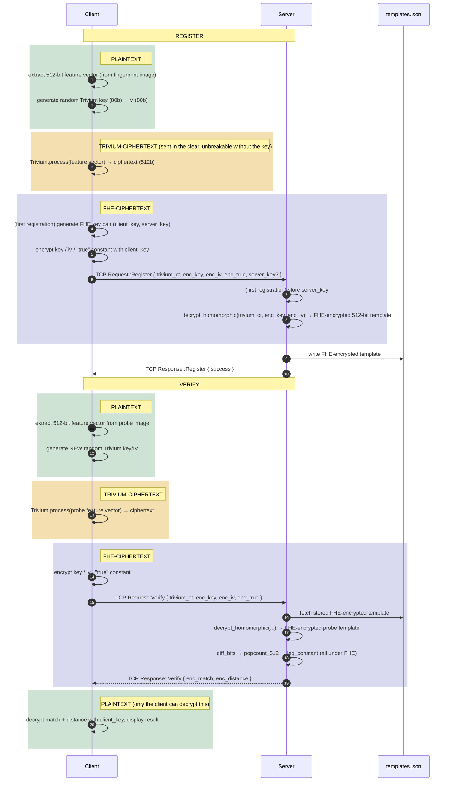

# fingerprint-fhe

A fingerprint verification prototype where the server **never** sees raw
(plaintext) fingerprint data. Privacy is achieved through a *transciphering*
scheme built on **Fully Homomorphic Encryption (FHE)** and **Trivium**, a
lightweight stream cipher.

> This is a research/prototype project. As honestly stated in "Known
> Limitations" below, biometric recognition accuracy is not yet
> production-grade. The project's main contribution is the end-to-end
> system design and performance evaluation of the FHE + transciphering
> pipeline, not recognition accuracy.

## Overview

The idea: the client extracts a 512-bit feature vector from the fingerprint
and encrypts it with **Trivium**, a lightweight stream cipher (this step
does not use FHE and is very fast). This ciphertext, together with the
Trivium key/IV, is sent to the server encrypted under FHE. The server runs
an FHE circuit of Trivium (`TriviumFhe`) to **homomorphically decrypt** this
data — the result always stays an `FheBool`, the server never sees any
plaintext at any point. Matching (Hamming distance + threshold comparison)
is also done entirely with FHE circuits, over encrypted data.

The goal of this approach is to avoid the (much higher) cost of encrypting
all the data directly under FHE: expensive FHE operations are limited to
Trivium's bounded circuit and the matching logic.

## Architecture and Protocol

```
client/   → Fingerprint reading, 512-bit feature extraction, Trivium + FHE key encryption, TCP client
server/   → TCP server, decrypt_homomorphic + FHE matching, templates.json database management
shared/   → Shared protocol (Request/Response), Trivium, TriviumFhe, FHE matching circuits, TCP framing (net.rs)
```

The client and server talk over TCP using length-prefixed JSON messages
(`shared::net`). The threat model is **honest-but-curious**: the server only
ever holds the FHE *evaluation key* (`server_key`), never the client's
*secret key* (`client_key`) — no matter how it deviates from the protocol,
it is structurally unable to decrypt any ciphertext it holds.

> **Note:** `client_key` is a single, global key per machine (not per
> user) — stored at `~/.fingerprint_client/client_key.bin`
> (`%APPDATA%\fingerprint_client\` on Windows). This is **not** a "one
> device, one key" model; it's a **deliberate design decision** modeling a
> supervised kiosk/workstation that enrolls multiple users: compromising
> this one file exposes every template registered from that station.



## Requirements

- Rust (2021 edition, `cargo`)
- Linux/macOS/Windows, **x86_64** (the `tfhe` FHE library is compiled for this architecture)

## Build and Run

```bash
git clone git@github.com:Rabiayvz/fingerprint-fhe.git
cd fingerprint-fhe

# Start the server (in its own terminal, runs continuously)
cd server && cargo run --release
```

Expected output:

```
2026-08-10T12:00:00.000000Z  INFO server: listening addr=127.0.0.1:7878
```

Run the client in another terminal:

```bash
cd client

# Register a new user
cargo run --release --bin client -- register user_101 ../data/fingerprints/101_1.tif

# Verify the same user with a different sample
cargo run --release --bin client -- verify user_101 ../data/fingerprints/101_2.tif
```

Set `RUST_LOG=info` (or `debug`) to see progress logs:

```bash
RUST_LOG=info cargo run --release --bin client -- register user_101 ../data/fingerprints/101_1.tif
```

> **Note:** the `client` package has multiple binaries (`client`,
> `bench_fhe`, `eval_accuracy`, `test_trivium_equivalence`,
> `stress_test_trivium_reduced_warmup`) — running `cargo run` without
> `--bin client` will fail.

### Timing Expectations

FHE key-pair generation on the first `register` call takes ~1 second.
`decrypt_homomorphic` (server-side transciphering) alone takes several
minutes — this runs once during `register` and once for the probe during
`verify`. The client's long timeouts account for this cost.

## Evaluation and Benchmark Scripts

```bash
cd client

# Plaintext accuracy evaluation (FAR/FRR/EER, over data/fingerprints/, finishes in seconds)
cargo run --release --bin eval_accuracy

# End-to-end performance measurement (transciphering vs. a pure-FHE baseline)
cargo run --release --bin bench_fhe

# TriviumFhe vs. plaintext Trivium equivalence test (N full-circuit trials)
cargo run --release --bin test_trivium_equivalence

# Stress-tests TriviumFhe's gate logic with a reduced warm-up round count (research-only, non-spec)
cargo run --release --bin stress_test_trivium_reduced_warmup
```

`eval_accuracy` output (measured on the FVC2002 DB1_B subset, 10 fingers ×
8 samples = 80 images):

| Metric | Value |
|---|---|
| Genuine pairs | 280 |
| Impostor pairs | 2880 |
| Approximate EER | ~46% |
| Server threshold | Hamming distance ≤ 194/512 bits (≈ 62% similarity) |

## Project Structure

```
fingerprint-fhe/
├── client/
│   ├── src/main.rs          → CLI (register / verify), TCP client, FHE key management
│   ├── src/feature_extraction.rs → 512-bit feature extraction (block-wise ridge orientation)
│   ├── src/matching.rs      → Plaintext Hamming distance helpers
│   └── src/bin/             → bench_fhe, eval_accuracy, test_trivium_equivalence, stress_test_*
├── server/src/main.rs       → TCP server, FHE matching, database management
├── shared/src/
│   ├── protocol.rs          → Request/Response message types
│   ├── net.rs               → Length-prefixed JSON framing (over TCP)
│   ├── trivium.rs / trivium_fhe.rs → Plaintext and FHE-circuit Trivium
│   └── matching_fhe.rs      → popcount, Hamming distance, threshold comparison (all under FHE)
├── data/fingerprints/       → FVC2002 DB1 (subset B) sample fingerprint images
└── database/                → server_key.bin, templates.json (both in .gitignore — generated locally)
```

## Known Limitations

- Prototype only: connections are handled sequentially (single-threaded), no TLS,
  limited to a localhost assumption.
- The FHE client key is single and global per machine (multiple users,
  one key — a deliberate design decision explained above).
- The feature extraction algorithm's discriminative power is still weak
  (EER ~46%) — this project's main contribution is the FHE/transciphering
  system design and its performance, with biometric recognition accuracy
  honestly reported as a limitation/future-work area.

## Dataset and License

The images under `data/fingerprints/` are from FVC2002 DB1 (subset B):

> D. Maio, D. Maltoni, R. Cappelli, J. L. Wayman, A. K. Jain, "FVC2002:
> Second Fingerprint Verification Competition," ICPR 2002.

Check the official source (biolab.csr.unibo.it/fvc2002) for current
redistribution terms.

No open-source license has been chosen for the code itself yet.
